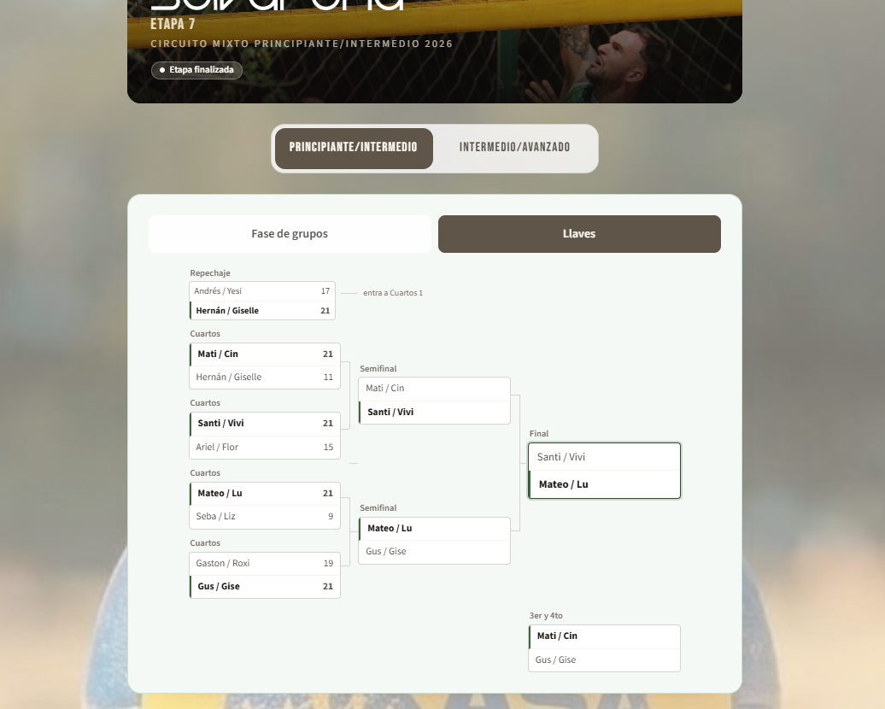
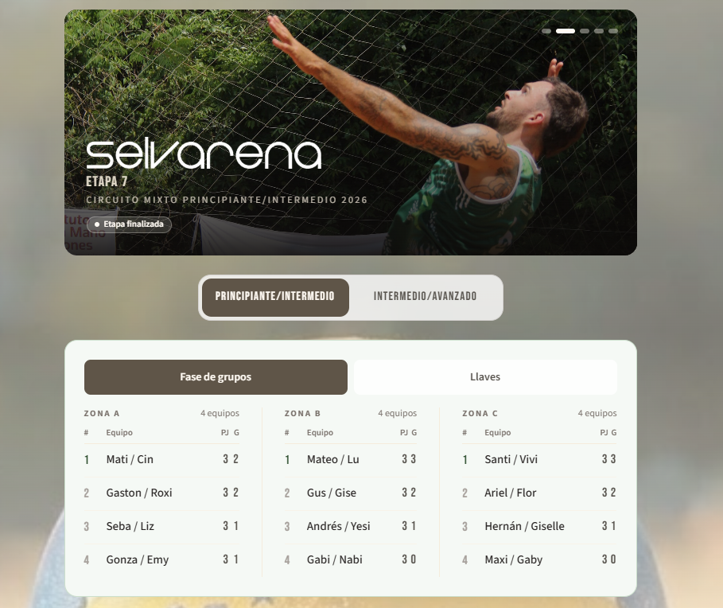

<div align="center">

# Eclipse

**Tournament management for volleyball.**
Live scoring, court scheduling, adaptive group formats and bracket generation — built for the people running the tournament, not for the audience.

**[Live app](https://selvarena.vercel.app)**

</div>




## The problem

A volleyball tournament is a chain of dependencies. Groups produce standings, standings produce brackets, and brackets depend on which court is free at what time. Every link has rules that are easy to get wrong by hand: a three-way circular tie needs a documented tiebreak criterion, and one delayed match invalidates the rest of the day.

Get one link wrong and the error surfaces hours later, in front of the players.

## What I built

- **Group stage with computed standings.** Position by matches won, then set difference, then point difference, then points for, then head-to-head. Three-way circular ties are resolved by an explicit criterion instead of a coin flip.
- **Configurable competition formats.** Three bracket layouts (`STANDARD`, `REPECHAJE`, `CUARTOS`) and four set formats (single set to 21, two sets to 15 plus tiebreak, two sets to 21 plus tiebreak to 15, best of three to 21). Format is configured per circuit, not hardcoded.
- **Court scheduling.** Matches are assigned to courts with a time estimate per match and manual reordering, so a delayed match propagates instead of silently breaking the day.
- **Live public view.** Scoreboard, standings, brackets and photo gallery, updated while the tournament runs. Installable as a PWA.
- **Organizer panel.** Create and close stages, enter results, publish changes. Single organizer role, no public signup.
- **Write guard on every mutation.** Results, stage closing, reordering and gallery changes reject unauthenticated requests at the route handler, not in the UI.

## Technical decisions

- **Prisma 7 with the libSQL adapter** — the same schema runs on local SQLite and on Turso in production. No second ORM, no environment-specific query layer.
- **Domain rules as pure functions.** Standings, zonification, bracket seeding, scheduling and tiebreak resolution are isolated from React and from Prisma, so they can be tested directly: 28 test files running on `node --test`, no test framework.
- **Stateless signed sessions.** HMAC-SHA256 cookie, scrypt password hashing with a per-user salt, and a login throttle keyed by IP + identifier. No session table to keep in sync across deploy instances.
- **Seven models, no generic abstraction.** `Etapa`, `Team`, `Match`, `ZoneTieResolution`, `TournamentState`, `CircuitSetting`, `User`. The tournament model is explicit because the rules are.

## Stack

```txt
Framework   Next.js 16 (App Router) · React 19
Language    TypeScript
Data        Prisma 7 · Turso (libSQL) · SQLite
Styling     Tailwind CSS
Tests       node --test · tsx (28 files)
Deploy      Vercel
```

## Run it locally

```bash
npm install
npx prisma migrate dev
npm run dev
```

Tests:

```bash
npm test
```

## Real use

Eclipse runs the tournaments organized by SELVARENA, the volleyball venue that hosts them in Misiones, Argentina. Multiple circuits per season, closed stages with published standings, and brackets generated from live results while the event is running. The screenshots above are from production.

## Roadmap

- CI on pull requests (typecheck + tests) and a tagged release with a changelog
- Coverage for the remaining route handlers, not just the domain layer
- Move the login throttle out of process memory so it survives multiple instances

## License

MIT
